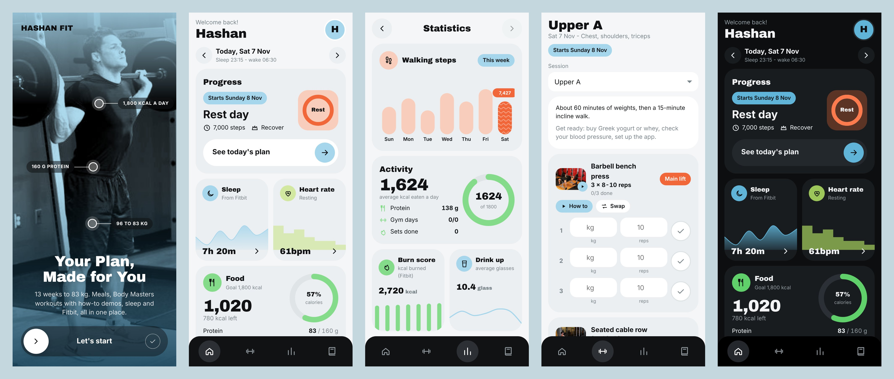

# Hashan Fit



A phone web app for Hashan's 3-month fat-loss plan. Install it to the iPhone home screen and it works offline.

- **Today**: calorie, protein, steps and water targets; meals with a one-tap usual breakfast and a Sri Lankan / Indian delivery guide; Lipo 6 window; Friday weigh-in; two-week check.
- **Workout**: the Body Masters program for each day and phase, with a **How to** demo (looping start/end photos, steps, mistakes) for every exercise, set logging, rest timer and swaps.
- **Progress**: weight against the plan line, weekly averages, strength trend.
- **Plan**: the full written plan, settings, backup, calendar reminders and Fitbit Air sync.

Plan document: [`docs/health-plan.md`](docs/health-plan.md). Fitbit setup: [`docs/google-health-setup.md`](docs/google-health-setup.md). Design: [`docs/superpowers/specs/2026-11-07-hashan-fitness-design.md`](docs/superpowers/specs/2026-11-07-hashan-fitness-design.md).

## Develop

```bash
npm install
npm run dev        # local app (Fitbit sync needs the Vercel functions)
npm test           # unit tests
npm run build      # calendar files + tests + type check + production build
npm run e2e        # phone-size smoke test against the build (uses the installed Playwright)
```

Data is stored on the phone (IndexedDB). The only server code is in `api/`: five Vercel functions for Google sign-in. They need these environment variables in Vercel: `GOOGLE_CLIENT_ID`, `GOOGLE_CLIENT_SECRET`, `TOKEN_ENC_KEY`, `ALLOWED_EMAIL`, `APP_ORIGIN`. Without them the app works and Fitbit sync says it is not set up.

Exercise photos come from [Free Exercise DB](https://github.com/yuhonas/free-exercise-db) (public domain, Unlicense). This is general fitness guidance, not medical advice.
